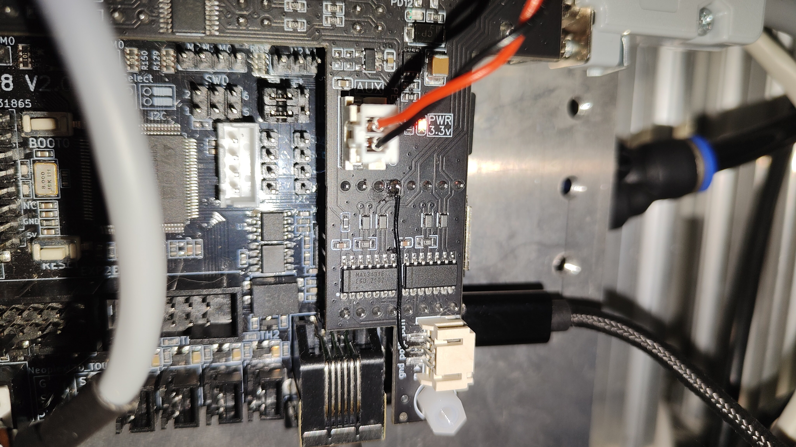
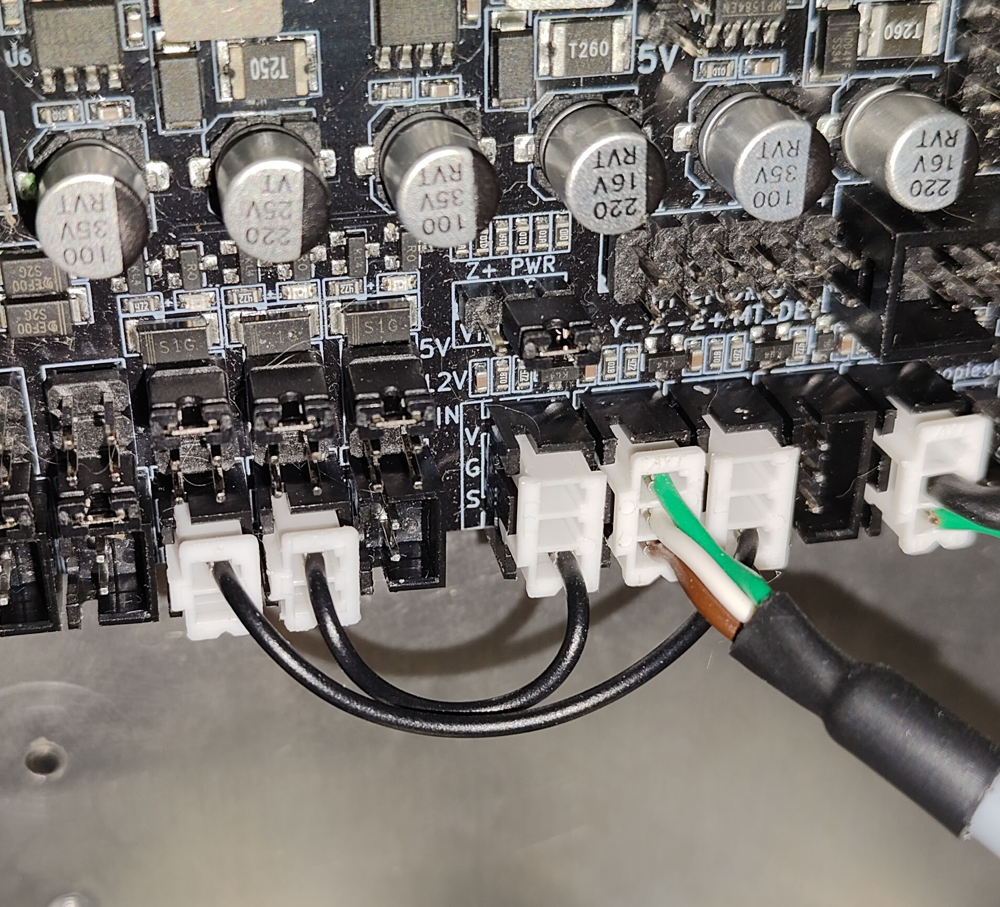

# MKS Monster8 V2 Custom Expansion Shield

Custom expansion shield designed for the **MKS Monster8 V2** mainboard to interface with industrial servo drives, high-speed actuators, and a differential host link.

## Key Features
* **5V Logic Level Shifters:** `74ACT244` high-speed line buffers converting 3.3V MCU `STEP` / `DIR` / `ENABLE` signals to clean 5V differential/single-ended drive inputs.
* **Isolated/Differential RS422 Host Interface:** Dual high-speed transceivers (`MAX3491` / dual-channel architecture) providing dedicated differential pairs for `RX`/`TX` and hardware `RTS`/`CTS` flow control (tested at 4 Mbps).
* **High-Speed Power Switches:** Fast `AON7296` MOSFET outputs for direct control of vacuum solenoid valves, blow-off valves, and camera illumination.

## Included Files
* `Schematic_MOSTER_SHIELD.pdf` — Full electrical schematic in PDF format.
* `Easy_EDA_SCH_MOSTER_SHIELD.json` — Editable schematic source file (EasyEDA Standard).
* `Easy_EDA_PCB_MOSTER_SHIELD.json` — Editable PCB layout source file (EasyEDA Standard).
* `PCB.png` — Top/bottom PCB routing preview.

## Hardware Modification for `RTS` Only (`Mode 2`)

If you configure **`rts_cts_handshake 2`** (`RTS` only on pin **`PA5`**, as used in the author's default configuration), solder a thin jumper wire from the `RTS` transceiver input to **`PA5`** on the shield header as shown below:



---

## CAN Bus Endstop Bridge (`X` and `Z` Axes)

The firmware supports up to **2 remote endstops** over the CAN bus (typically mounted on the moving toolhead for the **X** and **Z** axes).

### How It Works
Instead of injecting virtual flags directly into Smoothieware's internal endstop module, the CAN bridge physically drives designated GPIO output pins on the MCU. These output pins are jumpered directly to the standard hardware endstop inputs on the MKS Monster8 board. This hardware-loopback architecture creates a fail-safe bridge without altering or compromising Smoothieware's native endstop and homing logic.

* **Zero-Length CAN Frames (0-byte DLC):** Endstop states are encoded directly in the CAN Arbitration ID with zero payload bytes for minimum bus latency. Measured packet-to-pin processing latency is **~3 µs**, which is completely negligible during homing cycles even when combined with CAN frame transmission time.
* **Heartbeat & Fail-Safe Watchdog:** The remote CAN node must broadcast endstop status updates at least every **500 ms**. If CAN communication goes silent for more than **1500 ms** (timeout), the bridge automatically forces the output pins into an **alarm/triggered (closed)** state. This immediately halts motion and prevents a crash if the CAN cable disconnects during homing.

### CAN Protocol Table

| Axis | CAN ID (Triggered / Opened) | CAN ID (Idle / Closed) | Payload Length |
| :--- | :--- | :--- | :--- |
| **Axis X** | `0x10` | `0x11` | 0 bytes (DLC = 0) |
| **Axis Z** | `0x20` | `0x21` | 0 bytes (DLC = 0) |

### Configuration (`src/config.default`)
Assign the MCU GPIO pins that will output the received CAN endstop states:

```text
# --- CAN ENDSTOPS (id:0x11/0x10=X, 0x21/0x20=Z) ---
can_bridge.rx_endstops_enable                true             # Master switch for CAN endstops
can_bridge.x_endstop_pin                     PA1              # Destination pin for X axis trigger
can_bridge.z_endstop_pin                     PA0              # Destination pin for Z axis trigger
```

### Physical Wiring on MKS Monster8
Connect the configured CAN endstop output pins (`PA1` and `PA0`) directly to the standard `X-` and `Z-` endstop signal inputs on the MKS Monster8 board using jumper wires, as shown below:


